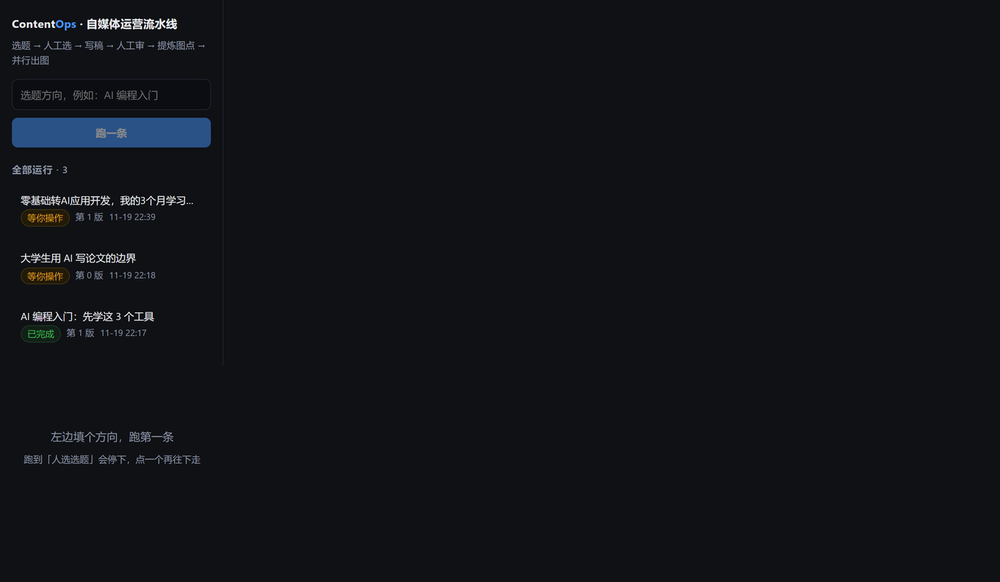
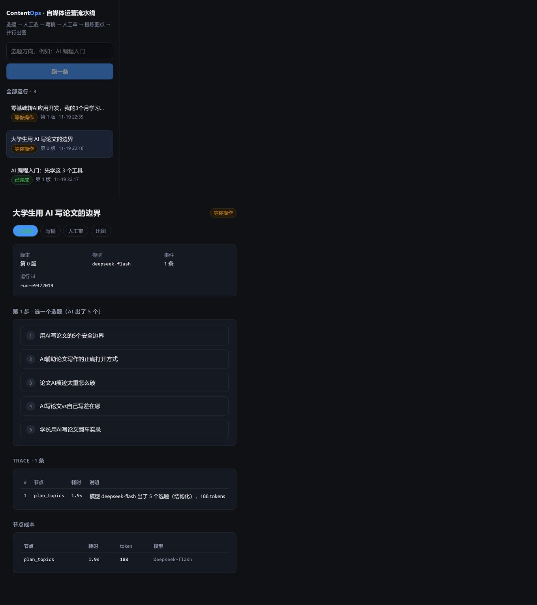
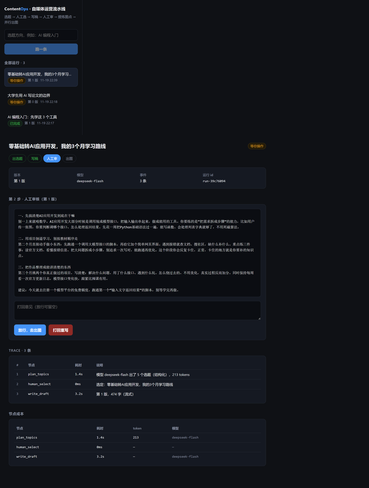
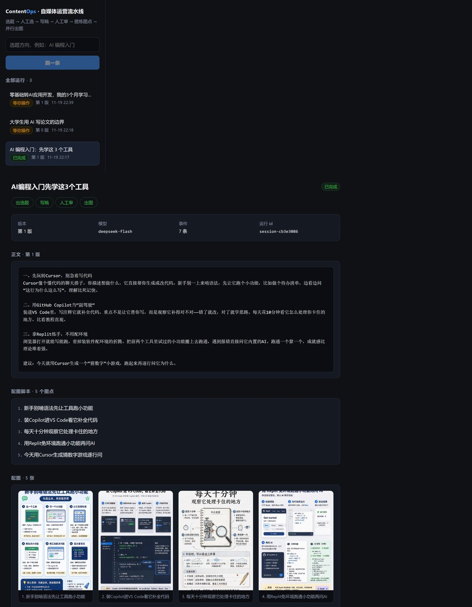

# ContentOps Agent · 自媒体运营 AI 智能体

[](https://github.com/linyi-bot/contentops-agent/actions/workflows/ci.yml)


> 一条「选题 → 人工选 → 写稿 → 人工审 → 提炼图点 → 并行出图」的内容流水线
> LangGraph 1.x 编排 · 两次真人中断 · 可观测 · 可跨进程恢复

仓库：<https://github.com/linyi-bot/contentops-agent>

**状态**：v0.7.0 · 77 条测试全绿 · CI 通过 · 六个节点 / 两次人工中断 / 三种状态后端 / Vue3 前端（无需构建）

---

## 一、它解决什么问题

内容团队最耗时的不是「写不出来」，是**每一次都要人从头盯到尾**：

- 选题要人想；
- 初稿要人改，改完不知道改到第几版；
- 配图要人拆图点、再一张张去生成；
- 人一走，流程就断在那儿。

这个项目把一条链路做成状态机：**能自动的自动，必须人决定的停下来等人，停多久都行**。

```
┌──────────────┐   ┌──────────────┐   ┌──────────────┐   ┌──────────────┐
│  plan_topics │ → │ human_select │ → │ write_draft  │ → │ human_review │
│  AI 出 5 个   │   │ 中断①：人选  │   │ 按选题写稿    │   │ 中断②：人审  │
└──────────────┘   └──────────────┘   └──────────────┘   └──────┬───────┘
                                                                │
                          ┌─────────────────────────────────────┴──────┐
                          │ approve                                    │ reject（带意见重写，最多 3 版）
                          ▼                                            ▼
                 ┌────────────────┐   ┌────────────────┐        ┌──────────────┐
                 │ extract_visuals│ → │ generate_images│ → END  │ write_draft  │
                 │ 提炼 3-5 个图点 │   │ 线程池并行出图  │        └──────────────┘
                 └────────────────┘   └────────────────┘
```

**两次中断是重点，不是装饰**：`interrupt()` 会把整个图挂起、状态写进 checkpointer，
进程可以退出。第二天换一个进程、用同一个 `thread_id` 就能接着跑 —— 这是「人在环里」和「先跑完再让人改」的本质区别。

---

## 二、快速开始

```bat
git clone https://github.com/linyi-bot/contentops-agent.git
cd contentops-agent
python -m venv .venv && .venv\Scripts\activate
pip install -e ".[test]"
contentops --help            :: run / resume / kb / llm-check / eval / serve

:: 一条命令跑完（mock 模型，不花钱）
contentops run --topic "AI 编程入门" --auto approve

:: 或者分三步，体验两次人工中断
contentops run --topic "AI 编程入门" --pause --db .contentops/cp.sqlite
contentops resume --thread-id <tid> --db .contentops/cp.sqlite --select 2
contentops resume --thread-id <tid> --db .contentops/cp.sqlite --decision approve
```

**打开界面**：

```bat
contentops serve --port 8000
:: Vue3 前端  http://127.0.0.1:8000/app/
:: 服务端渲染版 http://127.0.0.1:8000/
```

前端是三步入环：选选题（点卡片）→ 审稿（放行 / 打回带意见）→ 看成片（正文 + 图点 + 配图网格 + trace + 节点成本）。

---

## 界面

真模型（deepseek-flash）+ 真出图（火山 Seedream）跑出来的样子，不是占位图：

| 列表 | 选选题 |
|---|---|
|  |  |

| 人工审核 | 成品（正文 / 图点 / 配图） |
|---|---|
|  |  |

图里那条运行的实测数据：选题 1.4s / 写稿 3.2s（流式，能看到字一个个出来）/ 出图 31.7s 五张，
总花费约 ¥1（文本 ¥0.002 + 图 ¥1）。

---

---

## 三、技术栈

| 层 | 选型 | 为什么 |
|---|---|---|
| 编排 | LangGraph 1.x `StateGraph` + `interrupt()` + `Command(resume=)` | 1.0 的写法，不是网上那套 `interrupt_before` |
| 状态存储 | 内存 / SQLite / **PostgreSQL** 三选一 | 演示用内存、本机用 SQLite、企业口径用 PG（四张表自动建） |
| 后端 | FastAPI + Uvicorn | JSON API + SSE + 服务端渲染页面 |
| 前端 | Vue 3（`vue.global.prod.js`，无构建步骤） | 出网受限的机器上 `npm install` 随时会挂；打开即用 |
| 模型 | DeepSeek（OpenAI 兼容）/ mock | 没 key 自动回落 mock，CI 不花钱 |
| 出图 | mock（本地 SVG）/ 火山 Seedream / gemini 图像模型 | 三条通道，失败只影响单张图 |
| 观测 | 自建 trace（sqlite `runs`+`events`）+ `node_metrics` | 不接 LangSmith 也能看清每一步 |

---

## 四、目录结构

```text
contentops-agent/
├── src/contentops/
│   ├── state.py           # ArticleState：选题/草稿/图点/图 URL + trace + node_metrics
│   ├── nodes.py           # 六个节点（选题、人选、写稿、人审、图点、出图）
│   ├── graph.py           # 图组装 + 条件边 + 会话工具（session/start/resume）
│   ├── checkpoint.py      # 三种 checkpointer：内存 / SQLite / PostgreSQL
│   ├── image_service.py   # 出图三通道：mock / seedream / gemini
│   ├── llm.py             # 模型客户端 + mock（按提示词返回三种形状）
│   ├── trace_store.py     # runs + events 两张表
│   ├── output.py          # 成品 markdown
│   ├── web.py             # FastAPI：SSE、JSON API、服务端页面
│   └── cli.py             # run / resume / kb / llm-check / eval / serve
├── webapp/                # Vue3 前端（index.html + app.js + style.css + vendor/vue）
├── tests/                 # 55 条，含真起子进程的跨进程恢复
└── docs/                  # 看板、评测口径、讲述材料
```

---

## 五、API

| 方法 | 路径 | 说明 |
|---|---|---|
| `GET` | `/api/runs` | 运行列表 |
| `POST` | `/api/runs` | `{"topic": "..."}` → 出选题并停在中断① |
| `GET` | `/api/runs/{id}` | 运行详情：`run` + `state` + `packet` + `step` + `events` |
| `POST` | `/api/runs/{id}/select` | `{"selected_topic": "..."}` → 写稿，停在中断② |
| `POST` | `/api/runs/{id}/review` | `{"decision":"approve\|reject","note":"..."}` → 出图或重写 |
| `GET` | `/stream?topic=...` | SSE：`init → node* → interrupt → done` |
| `GET` | `/outputs/...` | 成品 md 与配图静态访问 |
| `GET` | `/healthz` | 容器健康检查 |

---

## 六、三个后端怎么选

| 后端 | 怎么开 | 场景 |
|---|---|---|
| 内存 `InMemorySaver` | 什么都不加 | 单测、单进程演示 |
| SQLite | `--db .contentops/cp.sqlite` | 本机跨进程：进程 A 停、进程 B 接着做 |
| PostgreSQL | `--pg contentops` | 多实例共享同一份状态；企业口径 |

PostgreSQL 那两个坑已经填平（代码里注释了原因）：

1. **建表必须 autocommit**：`setup()` 里有 `CREATE INDEX CONCURRENTLY`，不允许出现在事务块里；
2. **建表连接与运行期连接分开**，用完即关。

依赖是可选的，没装时给一句人话 + 退出码 2：

```bat
pip install "psycopg[binary]" langgraph-checkpoint-postgres
```

---

## 七、出图怎么接真模型

默认 `mock`：本地画 3:4 的 SVG 占位图，不联网不花钱，CI 里也能跑。

接真模型（任选其一，填进 `.env`）：

```ini
# 火山方舟 Seedream
IMAGE_PROVIDER=seedream
ARK_API_KEY=...

# 或 gemini 图像模型（OpenAI 兼容中转）
IMAGE_PROVIDER=gemini
IMAGE_API_KEY=...
IMAGE_BASE_URL=https://<你的中转站>
```

**不填 key 也不会崩**：`build_image_service()` 会回落 mock。出图失败只记 `image_errors`，不影响发稿。

---

## 八、测试

```bat
.venv\Scripts\python -m pytest -q      :: 55 passed
```

| 文件 | 守什么 |
|---|---|
| `test_smoke.py` | 整条链路：两次中断、六个节点顺序、成品 markdown |
| `test_stage2.py` | 解析容错、选择归一化、打回重写、额度上限 |
| `test_stage3.py` | 出图三通道：mock 产物、缺 key 回落、HTTP 失败不抛异常 |
| `test_stage4.py` | **真起三个进程**跑完 A 停 → B 选 → C 放行 |
| `test_stage5.py` | trace 落库幂等 + 页面三步人机接力 |
| `test_stage6.py` | 节点成本、SSE 帧序列、PostgreSQL 报错可照做 |
| `test_llm.py` / `test_packaging.py` | 模型客户端与打包合同 |

---

## 九、和课程「项目二」的关系

这套东西的骨架来自课程项目二的流程（选题 → 人工选 → 文案 → 人工审 → 出图），
实现上做了三处替换：

| | 课程项目二 | 本项目 |
|---|---|---|
| 题材 | 小红书内容运营 | 同一套流程，题材可换（`--platform`） |
| 存储 | PostgreSQL | 内存 / SQLite / PostgreSQL 三选一，测试不依赖数据库 |
| 观测 | LangSmith（要付费、要外网） | 自建 trace + 节点成本，离线可看 |
| 前端 | Vue3 + 构建链 | Vue3 但**无构建步骤**，受限环境也能演示 |

---

## 十、工程纵深（阶段 8）

课程 PDF 里列了 8 条「工程纵深」，这一版全部补齐：

| PDF 里的 | 落在这里 | 证据 |
|---|---|---|
| 子图 SubGraph | `graph.py` 里三张独立编译的子图（选题 / 写作 / 配图），主图编排它们 | `build_topics_subgraph()` 等 |
| 结构化输出 | `schemas.py`（Pydantic）+ `llm.complete_json()`（JSON Mode）；失败退回文本解析 | `test_structured_topics` |
| 历史 / 时间旅行 | `graph.history()` / `graph.rewind()`；CLI `contentops history` / `rewind`；API `/api/runs/{id}/history`、`/rewind` | `test_history_and_rewind` |
| token 级流式 | `llm.stream_complete()` + 节点里的 `token_sink`；`GET /stream/resume/{id}` 逐个推 `llm_token` | `test_stream_emits_llm_tokens` |
| JWT 鉴权 | `auth.py`（手写 HS256 + PBKDF2 用户库）；`CONTENTOPS_AUTH=on` 时 `/api/*` 要 Bearer token | `test_api_requires_token` |
| 双平台发布 | `publish` 节点出「小红书短文案 + 图集」「公众号长文」两版；`write_publish()` 落盘 | `test_write_publish_two_platforms` |
| 多模型路由 | `build_llm("cheap"/"smart")`：选题图点走小模型，正式稿走旗舰 | `test_model_routing_by_role` |
| 出图超时重试 | 指数退避 1s→2s→4s，最多次数 `IMAGE_RETRIES`；失败只记 `image_errors` | `test_seedream_retries_then_succeeds` |

两个实现上的取舍，面试也常被问：

1. **子图没直接挂在主图上**：直接把 `CompiledStateGraph` 当节点挂，每次 resume 主图会把子图连同上游重放一遍，`operator.add` 的 trace 会重复累加。所以包了一层 `_run_subgraph()`，只回传增量 —— 子图仍独立编译、可单测，但不参与父图的 checkpoint 语义。
2. **时间旅行靠 config 里的 `checkpoint_id`**：`update_state(cfg, {})` 在该检查点开一条新分支，再 `invoke(None, cfg)` 往下跑。`update_state()` 没有 `checkpoint_id` 参数，别照着旧文档写。

更细的取舍（10 条 ADR，含「为什么不接 LangSmith」「为什么前端不上 Vite」「旧评测为什么退役」）看
[`docs/决策记录.md`](docs/决策记录.md)。

---

## 十一、评测（阶段 9）

上一版的评测跟的是「检索 + 事实核查」，流程换掉后整条退役了。这一版按新流程重新定义**四项可机判指标**，
数据集是 12 条真实选题方向（`evals/topics/golden.jsonl`）：

```bat
contentops eval                      :: 全量 12 条，出报告到 reports/
contentops eval --limit 3            :: 抽三条先看看
contentops eval --image-provider ... :: 出图通道由环境变量决定
```

| 指标 | 机器判什么 | 本次（v2） |
|---|---|---:|
| 选题合格率 | 长度 8-24、无标题党词、5 条之间不同质（二字组重合 ≤ 0.8） | **96.7%** |
| 成稿合格率 | 250-1200 字、≥2 段、有小标题 | **100%** |
| 图点合格率 | 6-24 字、与正文有交集（中文字 + 英文词都算） | **97.9%** |
| 出图成功率 | 成功张数 / 图点张数 | **100%**（mock 通道） |

**11 / 12 通过**，平均 5369 ms、P95 6523 ms，12 条共 13352 token，**花费 ¥0.0284**。

失败的那条也留着：`Cursor 和 Claude Code 怎么选` —— 模型给出的两个选题被规则判为「同质」
（都是「Cursor + Claude Code + 对比」的变体），一个图点被判「与正文交集不足」。
**这条没修**，因为它是真实缺陷，不是规则的错。

报告里有「口径」一节，写明这四项**只测形状、不测内容质量**，别拿它当「准确率」讲。

---

## 十二、已知限制（写在明处）

- **评测不测内容质量**：四项指标都是形状约束，好文笔、事实正确与否机器判不了；
- **只采样一次**：没有做多次采样取均值，稳定性还没量化（`--repeat` 未实现）；
- **前端没打包**：`webapp/` 是「Vue 3 全局构建 + 一个 app.js」，不是 SFC，也没有 Vite；
  好处是打开即用，代价是没法用单文件组件语法。
- **Docker 镜像本机没 build 过**：文件齐（Dockerfile / compose / smoke 脚本），但这台机器没启 WSL2。

---

## 十三、版本

| 版本 | 变更 |
|---|---|
| 0.7.0 | 按新流程重做评测：四项可机判指标 + 12 条黄金方向 + 报告与口径（77 passed） |
| 0.6.0 | 工程纵深补齐：子图、结构化输出、时间旅行、token 级流式、JWT、双平台发布、多模型路由、出图重试（68 passed） |
| 0.5.0 | 换成「自媒体运营」六节点流程：两次 `interrupt`、并行出图、Vue3 前端、三种 checkpointer |
| 0.4.0 | 事实核查回写环 + 30 条黄金集评测（已随流程退役） |
| 0.3.0 | trace 落库 + 页面 + 打包 |
