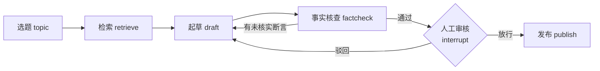

# ContentOps Agent

[](https://github.com/linyi-bot/contentops-agent/actions/workflows/ci.yml)


> 内容运营多智能体工作台 · LangGraph 编排 · 可评测、可观测、可复现

仓库：<https://github.com/linyi-bot/contentops-agent>
克隆：`git clone https://github.com/linyi-bot/contentops-agent.git`

一个「选题 → 检索 → 起草 → 事实核查 → 人工审核 → 发布」的六节点流水线。
它不是玩具 demo：每个节点都可单独测，每次运行留 trace，评测集能量化答对率与成本。

---

## 一、这个项目要证明什么

AI Agent 岗位的 JD 里反复出现这 7 个词，本项目一个不落地覆盖：

| JD 关键词 | 在本项目里对应什么 | 状态 |
|---|---|---|
| 编排（Orchestration） | LangGraph `StateGraph`，六节点 + 两条条件边（核查回写、人工打回） | ✅ 已完成 |
| 工具调用（Tool Use） | 检索工具已按 schema 接入；抓取 / 发布工具 | 检索 ✅，其余阶段 3 |
| RAG 检索增强 | 本地知识库 → 按二级标题分块 → BM25 式打分（单字 + 二元组）→ 拼上下文 | ✅ 已完成 |
| 评测（Eval） | 30 条黄金集，5 个指标出报告，失败样本逐条留原因 | ✅ 已完成（mock 基线；真模型待 key 重跑） |
| 可观测（Observability） | 自建 trace：每节点耗时 + 一句人话 + 该版烧了多少 token | ✅ 已完成 |
| 人工中断（Human-in-the-loop） | `interrupt()` 真暂停 + SQLite checkpointer：进程退出后换一个进程 `resume` 也能接着发布 | ✅ 已完成 |
| 部署（Deploy） | Docker 单机 + compose + 健康检查 | 🟡 镜像文件就绪，本机 WSL2 未启用（一键脚本见第六节） |

---

## 二、架构



当前已实现的是完整六节点闭环（阶段 1 的三节点 → 阶段 2 补齐核查、审核、发布）：

```
选题 ──▶ 检索(RAG) ──▶ 起草 ──▶ 事实核查 ──┬─有未核实断言──▶ 起草（最多 3 版）
         │              │                │
         └─ docs/kb/ ───┘                └─通过──▶ 人工审核(interrupt) ──┬─放行──▶ 发布
                                                                └─打回──▶ 起草（吃同一个额度）
```

### 核查与闸门（阶段 2 的判断规则）

事实核查只做两件**可机器判**的事，不做「语义上支不支持」的假装判断：

1. 每条断言必须带 `[n]`，且 n 落在本次检索到的条数范围内；
2. 被引那一段里，得能找到这条断言至少 2 个实字（或 1 个数字/单词）—— 专抓「引错了段」。

不通过的三类原因会原样进审核包：`没有引用标记` / `引用编号 N 不存在` / `引用 [N] 的段落里找不到这条断言的关键词`。
语义是否真的支持，留给人工 —— 这就是为什么下一个节点是 `interrupt()` 而不是自动发布。

三道闸门：

| 闸门 | 规则 | 代码位置 |
|---|---|---|
| 有证据 | 核查不过就回写，但最多 `MAX_REVISION=3` 版 | `graph.route_after_factcheck` |
| 有出路 | 零命中或额度用尽 → 交人，不空转 | 同上 |
| 不裸发 | 没有可核查断言（空稿、零命中）也**不算通过**，必须人工确认；发布记录里标 `forced` | `nodes.factcheck_node` / `nodes.publish_node` |

---

## 三、快速开始

```bat
:: 0) 拿代码（仓库已公开）
git clone https://github.com/linyi-bot/contentops-agent.git
cd contentops-agent

:: 1) 依赖
python -m pip install -r requirements.txt

:: 2) 让它知道自己是 src 布局的包（Windows 下 set，mac/linux 用 export）
set PYTHONPATH=src

:: 3) 跑一次：会停在【人工审核】，敲 y 放行 / n 打回（可跟一句附言）
python -m contentops.cli run --topic "用 AI 做周报自动化"

:: 4) 免交互跑完，并把发布记录落成 markdown（CI / 录屏用这个）
python -m contentops.cli run --topic "用 AI 做周报自动化" --auto approve --out outputs

:: 5) 跨进程恢复：A 跑到审核就退出（返回码 75），B 第二天接着发布
python -m contentops.cli run --topic "用 AI 做周报自动化" --db .contentops\state.sqlite --thread-id demo --pause
python -m contentops.cli resume --thread-id demo --db .contentops\state.sqlite --decision approve --out outputs

:: 6) 测试
python -m pytest -q

:: 7) 评测：30 条黄金集 → 汇总表 + 失败明细（报告写进 reports\）
python -m contentops.cli eval --dataset evals\golden --out reports
```

`scripts\dev.cmd` 只是把第 2 步和启动命令包了一下（Windows 专用，省得每次设环境变量）。

**人工审核长什么样**：图停在 `review` 节点，把审核包（选题、第几版、草稿、每条断言的核查结论）打印出来，
然后等一个答复。答复是 `Command(resume=...)` 喂回图的，不是命令行参数。
默认用内存 checkpointer（clone 下来零配置能跑）；加上 `--db` 就换成 SQLite checkpointer ——
状态落盘，**进程退出了也能换一个进程接着发**，`resume --decision reject` 打回后会在新进程里重写一版、再次停在审核。

**用真实模型**：把 `.env.example` 复制成 `.env`，填 `DEEPSEEK_API_KEY` 和 `LLM_PROVIDER=deepseek`，
然后先跑 `scripts\dev.cmd llm-check` 验通路（只花几十个 token），再跑正式流程。没填 key 时自动回落到 mock，
保证「clone 下来就能跑」——这是阶段 0 的验收线之一。

接 DeepSeek 时踩到 / 查到的三件事，都是会直接报错或直接多花钱的：

| 坑 | 表现 | 本项目怎么处理 |
|---|---|---|
| 模型 ID 是枚举 | 写 `deepseek-chat` 直接 400 | 官方现在只认 `deepseek-flash` / `deepseek-v4-pro`，默认值已改；`llm-check` 会把当前模型和 base_url 打出来 |
| 思考模式默认开 | 同一段草稿，输出 token 翻几倍 | 默认 `LLM_THINKING=off`（请求体里 `thinking.type=disabled`）；要开填 `on`，可选 `LLM_REASONING_EFFORT` |
| 价格分时段 | 拿一个固定单价算成本，高峰时段会少算一半 | 按北京时间工作日 9-12 / 14-18 取高峰价，其余半价；也可用 `LLM_PRICE_IN_HIT` / `LLM_PRICE_IN_MISS` / `LLM_PRICE_OUT` 覆盖 |

成本口径不写一个「总 token」了事：分别记 `prompt_cache_hit_tokens` / `prompt_cache_miss_tokens` /
`completion_tokens` —— 缓存命中的输入单价只有未命中的 1/50，混着算能把成本算高一个数量级。
每跑完一条，CLI 末尾会打「几次调用 / 多少 token / 估算多少钱」；评测报告里单独有「成本」一节。
调用失败也分得清：401/400 直接抛 `LLMError` 不重试，429/5xx/超时才退避重试（默认 2 次）。

---

## 四、目录

```
contentops-agent/
├── README.md
├── requirements.txt
├── Dockerfile                 # 单机镜像：非 root + HEALTHCHECK，不碰模型也能自检
├── docker-compose.yml         # 一条命令起容器；变量走 .env，没有就回落 mock
├── .dockerignore              # 把 .git / .probe / 产物挡在构建上下文外
├── .env.example
├── .gitignore
├── .github/workflows/ci.yml   # push 即跑 pytest
├── evals/golden/              # 30 条黄金集（10 常规 / 10 边界 / 10 应拒答）
├── reports/                   # 评测报告（每改一次闸门/提示词就留一份，A→B 的出处）
├── docs/
│   ├── kb/                    # 知识库（检索的语料，纯 markdown）
│   ├── 看板.md                 # 阶段 1–5 的任务看板（现在做哪张卡，只在这张表上）
│   ├── 评测口径.md             # 指标定义 + 三版实测数字 + 这组数不能说什么
│   ├── 讲述材料.md             # 3 分钟讲稿 + 录屏分镜 + 十个必问题
│   └── 简历回填模板.md
├── scripts/
│   ├── dev.cmd                # 设好 PYTHONPATH 再跑，避免环境污染
│   ├── docker-smoke.ps1       # 容器验收：build → 健康检查 → 真跑一条 → 抽 5 条黄金集
│   └── check_container_files.py  # 没装 Docker 时的静态校验（COPY 路径/变量/健康检查子命令）
├── src/contentops/
│   ├── state.py               # 图的状态定义（含断言 Claim 与审核包 ReviewPacket）
│   ├── llm.py                 # 模型层：mock / DeepSeek 统一接口 + 重试 + token/成本记账
│   ├── retriever.py           # 知识库分块、单字 + 二元组切分、BM25 式打分
│   ├── nodes.py               # 五个节点：检索 / 起草 / 核查 / 审核 / 发布
│   ├── graph.py               # 图的组装 + 两条条件边 + 会话（checkpointer）工具
│   ├── checkpoint.py          # SQLite checkpointer：状态落盘，跨进程恢复
│   ├── eval.py                # 评测器：跑黄金集、算指标、留失败明细、记成本
│   └── cli.py                 # 命令行入口（run / resume / kb / eval / llm-check）
└── tests/
    ├── test_smoke.py          # 链路能不能跑通
    ├── test_stage2.py         # 核查规则 / 中断 / 打回额度
    ├── test_stage3.py         # 评测器自身：数据集校验、闸门开关、失败明细
    ├── test_stage4.py         # SQLite checkpointer：真起子进程，A 暂停 → B 恢复
    └── test_llm.py            # 模型层：请求体、重试策略、记账口径、峰谷价（不联网）
```

---

## 五、评测（阶段 3 交付）

30 条黄金集，三个版本的代码各跑一遍（完整口径见 [`docs/评测口径.md`](docs/评测口径.md)）：

| 版本 | 引用命中率 | 事实一致性（代理） | 拒答准确率 | 端到端通过 | 平均 / P95 |
|---|---|---|---|---|---|
| v0.2 基线 | 100% | 7.5% | 10% | 4 / 30 | 32 / 41 ms |
| v0.3 修检索与 mock，不开闸门 | 100% | 55.0% | 0% | 20 / 30 | 32 / 38 ms |
| v0.3 加相关度闸门（0.09） | 100% | 91.7% | 100% | 30 / 30 | 33 / 40 ms |

三件事值得说，因为都能被追问：

1. **7.5% 那个数是 bug**：mock 解析上下文时按空行分块，第一块开头是「资料：」，
   于是第 1 条资料被整条丢掉、永远只引第 2、3 条 —— 表上表现为「引用命中率 100%、事实一致性 7.5%」。
   修完是 55.0%。
2. **拒答靠闸门**：检索最高分低于 0.09 就不写稿，不拿不相关段落硬凑。拒答 10% → 100%。
3. **这组数不是模型质量**：mock 只会照抄资料，语义对不对机器没判。它测的是流水线的行为
   （拦得住、拒得掉、不空转），换成真模型要重跑；也是因为这个，简历里没写「准确率 90%+」。

> 现在这张表是**跑出来的**，不是估的。每改一次闸门或提示词，`reports/` 里都要多一份，
> 对照着看 A→B —— 只报最新一次的数，等于没有基线。

---

## 六、容器化（阶段 3）

```bat
:: 构建 + 跑一条（mock，不花 token）
docker build -t contentops-agent:0.4 .
docker run --rm contentops-agent:0.4 run --topic "用 AI 做周报自动化" --auto approve

:: 或者 compose 起（自动读同目录 .env；没有 .env 就回落 mock）
docker compose up --build

:: 一条命令验收：build → 健康检查 → 真跑一条 → 抽 5 条黄金集
powershell -ExecutionPolicy Bypass -File scripts\docker-smoke.ps1
```

镜像里只有三样东西：源码、知识库、评测集。`.git` / `.probe` / 产物目录都被 `.dockerignore` 挡在外面。
容器以非 root 跑，`HEALTHCHECK` 故意不碰模型 —— 没有 key 也要能判断「镜像里的代码和知识库是活的」。
产物通过 `./outputs:/app/outputs` 出容器；`.contentops` 挂到 `./data`，容器重启后还能 `resume` 停在审核的会话。

> **本机现状（2026-11-19）**：这台机器没装 Docker，WSL2 功能也没启用（`LxssManager` 服务不存在）。
> 两者都要管理员权限 + 重启一次，`tools\install-docker.cmd` 就是为这一步写的：自己提权 → 查虚拟化 →
> 启用 WSL/虚拟机平台 → 装 WSL2 内核 → 装 Docker Desktop → 提示重启。
> 想先看它要动什么：`powershell -File tools\install-docker.ps1 -DryRun`（只体检，不改系统）。
> 在装好之前，`scripts\check_container_files.py` 会先做静态校验：COPY 的路径在不在、
> compose 引用的变量在 `.env.example` 里有没有、HEALTHCHECK 调的子命令注册没注册。

---

## 七、路线图

任务卡（现在做哪一张、卡在哪）看 [`docs/看板.md`](docs/看板.md)；这里只留总览。

| 阶段 | 天数 | 产出 | 验收线 |
|---|---|---|---|
| 0 地基 | 1 | git / 依赖 / 仓库 / README / CI | ✅ 已推到 GitHub，Actions 跑 pytest |
| 1 最小闭环 | 5 | 三节点 + 检索 + mock 模型 | ✅ 命令行跑通、有 commit |
| 2 主项目 MVP | 7 | 六节点 + 事实核查 + 人工中断 + 打回重写 | ✅ 带引用稿子产出，测试全绿（当前 34 条） |
| 3 工程化 | 5 | 评测集 + SQLite checkpointer + Docker + 打包 | 🟡 评测出数（30/30）✅、checkpointer 跨进程 ✅、Docker 文件与验收脚本 ✅（本机待装 WSL2）；打包未做 |
| 4 讲述 | 3 | 录屏 + 讲稿 + 10 问 | 脱稿 3 分钟讲完 |
| 5 投递 | 持续 | 简历回填 + 投递表 | 每周 ≥10 家 |

---

## 八、在受限环境里跑（可选）

如果目标机器是「没有管理员权限 + 出网受限 + 系统 TLS 损坏」的那类环境，
本项目刻意避开了三个依赖：不依赖 GPU、不依赖向量库、不依赖外部可观测平台。
另外两个实测坑值得记下来：

| 现象 | 真实原因 | 解法 |
|---|---|---|
| `pip install` 报 `PermissionError: ...whl` | Python 3.14 会把 `os.mkdir(mode=0o700)` 应用到目录 DACL，而 `tempfile.mkdtemp()` 默认就用 0o700；受限令牌因此进不去自己刚建的目录 | 用一个包装脚本把 0o700 改成 0o777 再调 pip（见提交历史里的 `pipx.py`） |
| `git push` 报 `error adding trust anchors from file: ...ca-bundle.crt` | MinGit 的 OpenSSL 打不开带中文的 CA 路径（工作区目录名里有中文） | 把 `ca-bundle.crt` 复制到纯 ASCII 目录（如 `%TEMP%`），`git -c http.sslCAInfo=<该路径> push` |
| `curl` / PowerShell 的 HTTPS 全挂 | schannel 凭证链损坏 | 出网一律走 Python `requests`；git 配 `http.sslBackend=openssl` |

