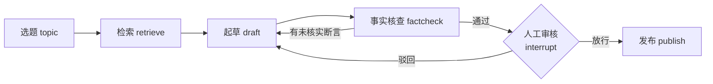

# ContentOps Agent

> 内容运营多智能体工作台 · LangGraph 编排 · 可评测、可观测、可复现

一个「选题 → 检索 → 起草 → 事实核查 → 人工审核 → 发布」的六节点流水线。
它不是玩具 demo：每个节点都可单独测，每次运行留 trace，评测集能量化答对率与成本。

---

## 一、这个项目要证明什么

AI Agent 岗位的 JD 里反复出现这 7 个词，本项目一个不落地覆盖：

| JD 关键词 | 在本项目里对应什么 | 状态 |
|---|---|---|
| 编排（Orchestration） | LangGraph `StateGraph`，六节点 + 条件边 | 阶段 2 |
| 工具调用（Tool Use） | 检索 / 抓取 / 发布三类工具，带参数 schema | 阶段 1（检索已完成） |
| RAG 检索增强 | 本地知识库 → 分块 → 检索 → 拼上下文 | 阶段 1 已完成 |
| 评测（Eval） | 30 条黄金集，4 个指标出报告 | 阶段 3 |
| 可观测（Observability） | 自建 trace 表 + 查看页，不依赖付费平台 | 阶段 3 |
| 人工中断（Human-in-the-loop） | `interrupt` 暂停等人工放行 | 阶段 2 |
| 部署（Deploy） | Docker 单机 + 公网隧道 | 阶段 3 |

---

## 二、架构



当前已实现（阶段 1）的是最小闭环，三个节点：

```
选题 ──▶ 检索(RAG) ──▶ 起草 ──▶ 输出
         │              │
         └─ docs/kb/ ───┘   ← 每次运行都留 trace
```

---

## 三、快速开始

```bat
:: 1) 依赖（本机已装好，见 .venv-libs；换机器时执行下一行）
python ..\tools\pipx.py install --target .venv-libs -r requirements.txt -i https://mirrors.aliyun.com/pypi/simple/

:: 2) 跑一次（默认 mock 模型，不需要 API key）
scripts\dev.cmd run --topic "用 AI 做周报自动化"

:: 3) 测试
scripts\dev.cmd test
```

**用真实模型**：把 `.env.example` 复制成 `.env`，填 `DEEPSEEK_API_KEY`，
然后 `set LLM_PROVIDER=deepseek` 再运行。没填 key 时自动回落到 mock，
保证「clone 下来就能跑」——这是阶段 0 的验收线之一。

---

## 四、目录

```
contentops-agent/
├── README.md
├── requirements.txt
├── .env.example
├── .gitignore
├── docs/
│   ├── kb/                    # 知识库（检索的语料，纯 markdown）
│   └── 评测口径.md             # 指标定义，阶段 3 填数
├── scripts/
│   └── dev.cmd                # 设好 PYTHONPATH 再跑，避免环境污染
├── src/contentops/
│   ├── state.py               # 图的状态定义（TypedDict + reducer）
│   ├── llm.py                 # 模型层：mock / deepseek 统一接口
│   ├── retriever.py           # 知识库分块与检索
│   ├── nodes.py               # 节点实现
│   ├── graph.py               # 图的组装
│   └── cli.py                 # 命令行入口
└── tests/
    └── test_smoke.py
```

---

## 五、评测口径（阶段 3 交付）

| 指标 | 定义 | 目标 |
|---|---|---|
| 引用命中率 | 草稿里每条引用都能在知识库中找到出处 | ≥ 90% |
| 事实一致性 | 黄金集 30 条里核查节点判「通过」且人工判对的占比 | ≥ 85% |
| 平均 token 成本 | 单次运行 input+output token | 记录基线，逐版下降 |
| P95 延迟 | 端到端耗时 95 分位 | < 20s（mock 本地） |

> 现在这张表是空的，填数之前**不许写进简历**。等阶段 3 跑出报告，再用真实数字回填。

---

## 六、路线图

| 阶段 | 天数 | 产出 | 验收线 |
|---|---|---|---|
| 0 地基 | 1 | git / 依赖 / 仓库 / README | `git push` 成功（待 GitHub 认证） |
| 1 最小闭环 | 5 | 三节点 + 检索 + mock 模型 | 命令行跑通、有 commit ✅ |
| 2 主项目 MVP | 7 | 六节点 + 事实核查 + 人工中断 | 输入选题产出带引用稿子 |
| 3 工程化 | 5 | 评测集 + trace + Docker | pytest 绿、评测出报告 |
| 4 讲述 | 3 | 录屏 + 讲稿 + 10 问 | 脱稿 3 分钟讲完 |
| 5 投递 | 持续 | 简历回填 + 投递表 | 每周 ≥10 家 |

---

## 七、这台机器的环境坑（换机器可忽略）

| 现象 | 真实原因 | 解法 |
|---|---|---|
| `pip install` 报 `PermissionError: ...whl` | Python 3.14 把 `os.mkdir(mode=0o700)` 应用到 Windows 目录 DACL，沙箱令牌访问不了 `tempfile.mkdtemp` 建的目录 | 用 `tools/pipx.py` 代替 `python -m pip` |
| `curl` / PS 的 HTTPS 全挂 | 系统 schannel 凭证链损坏 | 一律用 Python `requests`，git 走 `http.sslBackend=openssl` |
| pypi 直连超时 | 出网限制 | 用阿里云镜像 `mirrors.aliyun.com/pypi/simple/` |
| `git` 命令不存在 | 本机没装 git，项目用的是工作区内的便携版 | 用 `tools\git.cmd`，不要直接敲 `git` |
